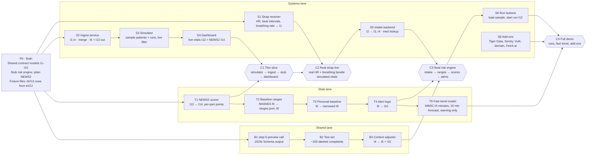

# Build Order

Oct 17, 2026 · @Nate

Three lanes run in parallel from the start: systems, stats, and a shared lane for the context adjuster. They meet at four checkpoints, and each checkpoint leaves the demo runnable. Within a lane, the riskiest integration goes first. Interface IDs (I1–I17) refer to [component-map.md](component-map.md).

## Lanes and checkpoints

Read left to right: everything in one column can be built at the same time. A checkpoint needs every arrow into it before the two lanes plug together.

## Steps

| Step | Owner | Needs | Done when |
| --- | --- | --- | --- |
| P0 Contracts and stubs | Both | — | Shared models for I1–I15 exist; a stub risk engine returns plain NEWS2 as I9/I14; eICU fixture rows load as I6/I13 |
| S1 Strap receiver | Systems | P0 | bleakheart prints HR and beat intervals; receiver sends I1 with breathing rate; reconnects on drop. Done: receiver/, scripts/hardware/ |
| S2 Ingest service | Systems | P0 | Accepts I1 over WebSocket, merges sources per vital, emits I13 each second and I6 each minute; run mode drops strap readings and freezes when a run ends (component-map, Simulator runs). Done: backend/app.py, backend/ingest/, tests/ingest/ |
| S3 Simulator | Systems | P0 (S2 to plug in) | Six sample patients play fixed-length runs through the `RunSink` interface, with run state and a 120-minute trend pre-roll. Done: backend/simulator/, scripts/simulate_run.py. Still to build: the live-mode filler of SpO2 and temperature for C2, and ingest's side of the sink (S2). Integration testing is blocked on S2, T4, S5 and S6 (checks listed in simulation-layer.md) |
| S4 Dashboard | Systems | S3 | Shows live vitals and NEWS2 updating every second from the stub |
| T1 NEWS2 scorer | Stats | P0 | P0 stub already scores the full table; T1 checks it against reference cases, covers edge cases and missing parts, and owns scoring from here. Done: NaN rejection, tests/risk_engine/test_news2.py |
| **C1 Thin slice** | Both | S4, T1 | Simulated vitals flow end to end and NEWS2 moves on the dashboard |
| **C2 Real strap live** | Systems | C1, S1 | The wearer's real HR and breathing rate show next to simulated SpO2 and temperature |
| S5 Intake backend (reduced) | Systems | C2 to plug in | Backend only: `backend/intake/` (lookup, service, routes) and the dev app `scripts/intake_app.py`. Posting I2 assigns the wearable (I3), produces I4 with drug classes from a small hardcoded table, and applies the adjuster's I5 in two steps. The page itself is built with S4. Wired into `backend/app.py` (intake routes mounted; I3 goes to ingest `assign`); the dev app stays for its selftest |
| T2 Baseline ranges | Stats | T1 | NHANES quantile fit written to ranges.json; engine builds I8 from I4. Done: training/fit_ranges.py, backend/risk_engine/ranges.py |
| T3 Personal baseline | Stats | T2 | I6 rows narrow the safe band; danger limits move only via I5. Done: backend/risk_engine/baseline.py (hr and breathing) |
| T4 Alert logic | Stats | Step A | Recorded I9 rows produce I10 alerts with persistence windows and one alert per problem. Done: backend/risk_engine/alerts.py, tests/risk_engine/test_alerts.py, training/tune_alerts.py, replay_fixture --alerts |
| B1 step-5-preview call | Both | P0 | A test call returns valid JSON matching the I5/I15 schema. Done: backend/llm.py, backend/adjuster/proposal.py, scripts/stepfun_smoke.py |
| B2 Test set | Both | B1 | About 100 labeled chief complaints, including negations. Done: fixtures/adjuster (30 dev, 70 test), models/rules.json, notes/adjuster-labeling-guide.md |
| B3 Context adjuster | Both | B2 | I4 in, I5 to the engine, I15 to the evaluation log; quote check enforced; scored on the test set. Done: backend/adjuster/ (rules.py, prompt.py, adjuster.py), ranges.apply_i5 wired into on_intake, scripts/score_adjuster.py (selftest, offline, live); test split precision 1.000, recall 0.982 (decisions.md B3) |
| **C3 Real risk engine** | Both | S5, T4, B3 | A typed intake changes the wearer's ranges, and live scoring and alerts run on the real engine |
| S6 Run buttons | Systems | C3 | The intake form prefills a sample patient and a dashboard button starts its run; scores react and the end shows as a pause |
| Step A Trend wiring | Stats | T3 | I9 carries per-vital levels and trend fields (null with the stub), I10/I11 contracts and typed alert/trend config exist, `trend.py` and a stub `fast_model.py` are wired into the engine. Done: backend/risk_engine/trend.py, tests/risk_engine/test_trend.py |
| T6 Fast trend model | Stats | Step A | The 15 min model replaces the stub; tier and reason appear in I9. Done: LightGBM forecast model ships (METHOD "forecast", cutoff 2.0, warning only; Rule 1/2 and logistic stay selectable); training/, backend/risk_engine/fast_features.py, fast_model.py, models/fast_15_forecast*. Retrain pending when the second MIMIC batch finishes downloading |
| S8 Add-ons | Systems | any time | Tiger Data stores readings, Sentry tracing + logs, hosted on Vultr behind a domain, Fetch.ai agent answers in ASI:One |
| **C4 Full demo** | Both | S6, T6 (S8 if done) | The demo script runs start to finish without touching code |
| K1 Condition test set | Both | B2 | 40 invented and 60 real conditions (lay terms, typos, rare), terms that match several entries, 20 injection strings, about 25 rule-match labels, 10 no-effect conditions; `scripts/score_conditions.py` |
| K2 Lookup and gate | Both | K1 | Code only: NLM client, fuzzy match, found / ambiguous / not_found (I16); targets 1–3 and 5 pass with no model |
| K3 Normalizer | Both | K2 | One model call returning the canonical term and search terms, cached; measured on K1 |
| K4 Rule matcher | Both | K2, B3 | Vocabulary code to a `rules.json` entry; the existing adjuster path runs unchanged. Also write the limit menu (`models/limit_menu.json`) and replay each entry on eICU to measure its alert load |
| K5 Evidence step and warning-only apply | Both | K3, K4, T2 | Code-run PubMed search and fetch, one model call picks from the limit menu (never a number), code gates, saved evidence (I17); the engine applies the warning tier in `ranges.py`; on from the start with one kill-switch flag |
| K6 Intake page wiring | Systems | K2, S4 | Custom-conditions field, a picker for several matches, and a profile card showing status, changed limits, quotes or sources, evidence label and "unreviewed"; `GET /intake/{patient_id}` adds I16 and drafted items |
| **C5 Custom-condition demo** | Both | K5, K6, C3 | On the intake page: type a condition, see the limits and their sources on the card, start a run, watch the warning fire |

T5 (the slow sepsis model) was dropped and has no row; the fast model is the only trend model (decisions.md). T4 and T6 are done and feed C3 and C4 as listed.

The K steps (the custom-condition path) are specified in [agentic-llm-plan.md](agentic-llm-plan.md); the diagram above does not show them.

Fetch.ai steps, deferred until the K steps work without it (later wrap, no change to K):

| Step | Owner | Needs | Done when |
| --- | --- | --- | --- |
| F1 Fetch.ai spike | Systems | any time (early, timeboxed) | One uAgent with the Chat Protocol and mailbox, registered on Agentverse, answers "risk status" from stored I9 rows in ASI:One. Riskiest: discovery, venue Wi-Fi, chat timeout against the 25–45 s model call |
| F2 Tool gateway and coordinator | Systems | F1, S5 | Typed tools over existing routes (register patient, risk status, run scenario), two permission tiers, a call log kept by the gateway, step and token caps. The model writes a JSON plan from a fixed tool list, code validates and runs it, two re-plans at most |
| F3 Four agents | Systems | F2, K5, K6 | Intake, evidence and monitor agents registered; interactive cards last |

## Order of risk

Riskiest first in each lane, because each could force a plan change:

1. **S1:** the strap's Bluetooth connection and breathing rate from beat intervals.
2. **B1:** access to step-5-preview and its structured output.
3. **T2:** whether the NHANES fit gives sensible ranges by profile.
4. **T6:** the MIMIC-III download size and speed (slow server); done on a sample, retrain pending the second batch.
