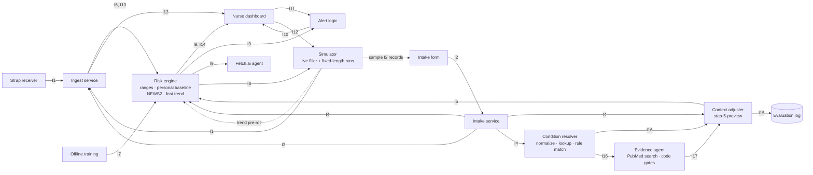

# Component Map and Interfaces

Oct 17, 2026 · @Nate

Every functional component, its owner, and the 17 interfaces between them (I16 and I17 serve the agentic condition path in [agentic-llm-plan.md](agentic-llm-plan.md)). Build to these contracts so systems work and risk-model work run in parallel. Mirrors the [component map artifact](https://claude.ai/artifact/K5NvykgaQGoM5qhpP95fXL); if a contract changes, change it here first.

The demo has two modes. Live: one patient, the wearer. Simulation: a six-patient waiting-room scenario (below the run mode text) with a fast-forward button. The single-run text: In live mode the strap supplies real heart rate and breathing rate and the simulator fills in SpO2 and temperature. In run mode the nurse loads one of six sample patients and starts a fixed-length run in which the simulator supplies every vital and the strap is ignored; BP, alertness and the oxygen flag come from the sample's intake record ([simulation-layer.md](simulation-layer.md)). No real/simulated tag in the data; the pitch says which is which.

## Diagram

Inside the risk engine, baseline ranges pass I8 to the personal baseline, scorers and alert logic. Sentry tracing and logs wrap the receiver, ingest, intake, risk engine and alerts.

## Components

| Component | Owner | Does | Reads | Writes | Start against |
| --- | --- | --- | --- | --- | --- |
| Strap receiver | Systems | Polar H10 over Bluetooth (bleakheart); HR + beat intervals about 1 Hz; contact flag; auto-reconnect; computes breathing rate | Bluetooth | I1 | The strap, printing to the console |
| Simulator | Systems | Six sample patients (I2 records), each with a fixed-length run that scripts every vital while the strap is ignored; 120-minute trend pre-roll; run state; live mode fills SpO2 and temp | I12, I8 (live mode only) | I1, sample I2 records, run state, trend pre-roll | A fake sink; `scripts/simulate_run.py` |
| Demo intake page (built with S4) | Systems | Nurse enters profile, conditions, meds, triage set, chief complaint; auto patient ID; assigns wearable; can prefill from a sample patient | Nurse input, sample I2 records | I2 | Nothing |
| Ingest service | Systems | FastAPI + WebSocket; one entry function takes the source (strap or simulator); live mode merges strap and simulator per vital, run mode drops strap readings; wearable → patient; signal quality; rolling 30 s medians, newest-second `latest` values and 30 s period medians; breathing rate dropped; freezes when a run ends; storage (Tiger Data) | I1, I3 | I6, I13 | Simulator |
| Intake service | Systems | Validates and stores the record; medication name → drug class (small hardcoded table, `backend/intake/lookup.py`); builds patient context | I2 | I3, I4 | Hand-written intake records |
| Context adjuster | Both | Code rules (age, drug classes, pregnant flag) plus one step-5-preview call that reads the chief complaint for facts and quotes; values come from rules.json; evidence logged separately | I4 | I5, I15 | The ~100 self-written test texts |
| Evaluation log | Both | Facts + exact quotes per adjustment; scored against the test set | I15 | — | — |
| Offline training | Stats | NHANES quantile fit; MIMIC-III minutes (fast trend, 15 min; the PhysioNet 2019 slow model, T5, is dropped); eICU replay to tune baseline settings (k, floors), windows, cutoffs | Public datasets | I7 | Nothing |
| Risk engine | Stats | Python module, entry points at intake, every second (NEWS2), every period (baseline, fast trend), and a history seed for the trend model | I4, I5, I6, I7, I13, trend history | I8, I9, I14 | I6/I13 rows from eICU and recorded strap data |
| Alert logic | Stats | Persistence windows; NEWS2 ≥5 urgent, ≥7 high; one alert per problem; worsening supersedes; stays until acknowledged, then resolved | I9, I11 | I10 | Recorded I9 rows |
| Nurse dashboard | Systems | Live vitals + NEWS2 each second; reason and NEWS2 points; ranges and trends; acknowledge, run buttons and a "Run ended" label | I8, I9, I10, I13, I14 | I11, I12 | Stub risk engine (plain NEWS2) |
| Condition resolver | Both | Normalizes typed conditions (one model call), looks each up in public vocabularies, matches a table rule; ambiguous matches go back to the nurse as a question | I2 custom conditions, I4 | I16 | Hand-written typed conditions |
| Evidence step | Both | For a real condition with no table rule: code searches PubMed and fetches abstracts, one model call picks a vital, a bound and a menu step (never a number) with supporting passages, runs the code gates; evidence is saved and reused per condition | I16, limit menu (I7) | I17 | The sources already in `rules.json` |
| Fetch.ai agents | Systems | ASI:One chat entry (coordinator `rider-triage`), intake agent and evidence agent on Agentverse; the backend bridge sends adjust and condition requests to them and falls back in-process. No messaging, no acknowledge, no ranking from the new tools. See agentic-llm-plan.md, "Fetch.ai agents" | I9, I10, intake routes, I2, I4, I5, I15, I16, I17 | Chat answers | Stored I9 rows |

## Interface contracts

Shared rules: timestamps are LA local time with the UTC offset (`2026-10-18T10:15:03-07:00`); units are metric and °C; every field is nullable and a null is ignored, never filled in.

| ID | Name | From → To | Transport · cadence | Status |
| --- | --- | --- | --- | --- |
| I1 | Vitals reading | Strap receiver, Simulator → Ingest | WebSocket · about 1/s per source | Decided |
| I2 | Intake record | Intake form → Intake service | HTTP POST · once per patient | Decided |
| I3 | Wearable assignment | Intake service → Ingest | In-process call · on intake or reassignment | Tentative |
| I4 | Patient context | Intake service → Context adjuster, Baseline ranges | Function call · once at intake | Tentative |
| I5 | Context adjustments | Context adjuster → Baseline ranges | Function call · once at intake | Tentative |
| I6 | Period summary | Ingest → Risk engine | Function call · every period (30 s live) | Decided |
| I7 | Model files | Offline training → Risk engine | Files in models/ · loaded at startup | Tentative |
| I8 | Patient ranges | Baseline ranges → Personal baseline, scorers, alert logic, Simulator, Dashboard | In memory · set at intake, narrowed each period | Tentative |
| I9 | Risk result | Risk engine → Alert logic, Dashboard, storage, Fetch.ai agent | WebSocket push to dashboard · every period (30 s live) | Decided |
| I10 | Alert | Alert logic → Dashboard | WebSocket · when it fires or resolves | Tentative |
| I11 | Acknowledgment | Dashboard → Alert logic | WebSocket · on click | Decided |
| I12 | Scenario trigger | Dashboard → Simulator | WebSocket · on run button | Tentative |
| I13 | Live window | Ingest → NEWS2 scorer (function call), Dashboard (WebSocket) | Every second | Tentative |
| I14 | Live NEWS2 | NEWS2 scorer → Dashboard | WebSocket · every second | Decided |
| I15 | Adjustment evidence | Context adjuster → Evaluation log | Append to file · once per intake | Tentative |
| I16 | Condition resolution | Condition resolver → Context adjuster, Evidence agent, profile card | Function call · once per intake, off the critical path | Tentative |
| I17 | Drafted rule | Evidence agent → Context adjuster | Function call · once per novel condition, then served from the evidence store | Tentative |

### Wire and scoring rules (fixed in P0)

Affects S2, S4, S5, T1, B1. Models live in `backend/contracts.py`; JSON Schema is exported to `schemas/`.

- **Field types:** every field nullable, default null, IDs included. Unknown fields are rejected. Timestamps must be timezone-aware; naive ones are rejected. Enumerated values are literal string sets exactly as listed below.
- **WebSocket envelope:** every message is `{"type": "<interface ID>", "data": {...}}`. An I1 message from the receiver may also carry `sentry_trace` and `baggage` (strings) so one Sentry trace spans receiver and ingest; they are absent when Sentry is off. Affects: receiver, ingest.
- **Endpoints (tentative):** `GET /health` returns `{ok: true}` (the Sentry uptime check). `WS /ws/ingest` accepts I1. `WS /ws/dashboard` pushes I8, I9, I10, I13, I14 and accepts I11, I12. `POST /intake` takes I2 and returns the I3 assignment (422 for a missing or unknown wearable_id). Form contract routes (`backend/intake/routes.py`): `GET /intake/wearer` (the wearer's I2 record for prefill), `GET /intake/wearables` (list of `{wearable_id, label, patient_id, simulated}`; `simulated` is true for the six sim wearables so the frontend hides them in Live mode), `GET /intake/{patient_id}` (profile card: I4, current I8, I5, I15 items and adjuster state pending, done or structured only). Simulator routes: `GET /sim/profiles`, `GET /sim/profiles/{id}` (the sample's I2 record), `GET /sim/run`, `POST /sim/run`, `POST /sim/run/stop`, `POST /sim/run/reset`. Scenario routes: `POST /sim/scenario` (202, RunStatus with kind "scenario"; 409 while a run is going), `POST /sim/skip` body `{minutes}` (waits for the replay, returns RunStatus `{state, kind, profile_id, patient_id, sim_now}`; 409 if no scenario is running), and stop, reset and `GET /sim/run` also cover the scenario (reset drops every scenario patient). `RunStatus` gains `kind` ("single" | "scenario" | null) and `sim_now` (LA timestamp or null). Patient routes: `GET /patients` (list of `{patient_id, name, arrival_ts, bed, wearable_id, called_in_ts, simulated, alerts}`; `alerts` are the patient's open I10 alerts), `POST /patients/{id}/called-in` (sets called_in_ts, returns the row; 404 unknown) and `GET /patients/{id}/history` (the patient's I9 rows since arrival, oldest first). I12's scenario_id does not cover the waiting room; the frontend uses the HTTP routes. `POST /sim/run` takes `{profile_id, patient_id?, wearable_id?}` and returns `202` with `{state, profile_id, patient_id}`; `404` for an unknown sample patient, `409` while a run is going. Sample records carry no `wearable_id` (the nurse picks it): after intake the caller passes the patient and the wearable from I3, otherwise the sample's own id and the default wearable are used.
- **Band edges:** safe_low/safe_high and danger_low/danger_high are inclusive; a value at or below danger_low (or at or above danger_high) is danger. Stub I8: NEWS2 score-0 range is safe, score-3 values are danger. spo2 and temp_c have null danger_high.
- **Null scoring:** a null vital gets null points and is left out of the total; never filled in.
- **Rounding:** HR, RR and SpO2 round to whole numbers and temp_c to one decimal before banding, rounding half up (20.5 breaths becomes 21, 2 points; 24.5 becomes 25, 3 points).
- **NaN and infinity:** rejected by every model, so ingest (S2) must drop a non-finite reading (treat it as null) before building I6 or I13. `news2.score` also treats them as null for direct callers.
- **news2_points range:** 0-3 each, except on_oxygen which is 0 or 2.
- **SBP, alertness, on_oxygen** in I14 come from I4 triage held in engine state; with no intake they are null.
- **Cadence:** I6 is per period: 30 s live, 5 minutes for eICU, 1 minute for MIMIC. eICU is 5-minute, so fixtures never repeat a value into five rows; the I13 loader holds the latest I6 for up to 5 minutes, then null.
- **T1-T3 additions (affect S2, S3, S5):**
  - I8 safe band is always inside the NEWS2 score-0 range (the NHANES fit and the personal baseline can only tighten it), so a value shown as safe never scores NEWS2 points.
  - The live-mode filler (S3) generates from the intake-time population I8 (`engine.intake_ranges[patient_id]`), never the personal one, to avoid learning its own noise. Scripted runs do not read I8.
  - Only hr and resp_rate get a personal band. spo2, temp_c and sbp stay population. Danger never moves in T1-T3.
  - `RiskEngine.on_period` returns I9 only. When a patient's I8 changes it calls `engine.ranges_listener(PatientRanges)` so S2 can push I8 to the dashboard. `engine.ranges` is the current I8 per patient.
  - Triage SBP is typed at intake (S5), never generated by the simulator. A sample patient's I2 record carries its own triage values and prefills the form.
  - Pregnancy is not modelled in the population fit; the rule comes with the context adjuster.
- **Step A additions (affect S2, S4, S5, Fetch.ai agent):**
  - I9 gains per-vital levels and values and the trend tier and reason; `trend_prob_slow` is removed (T5 dropped, see decisions.md). `news2` and `news2_points` are null when the latest I14 is over 60 s older than the minute.
  - I10 gains `vital`, `supersedes` (a list) and `resolved`. alert_id is deterministic (patient, key, timestamp). A resolved update re-sends the same alert_id with `resolved` true.
  - I11 is decided: dashboard only, fields unchanged. Acknowledging any alert in a supersede chain acknowledges the current head.
  - I7 config gains flat typed `alerts` and `trend` blocks with defaults in `contracts.py`; the `persistence_windows` and `probability_cutoffs` dicts are gone.
  - Bed labels live in `backend/config.py` (wearable 1 is "Bed 4"); the lookup reads the wearable from the engine's stored I4 and falls back to patient_id.
  - `RiskEngine.on_period` calls `trend.py` once; with the stub fast model every trend field stays null and I9 is otherwise unchanged.
- **Simulator runs (affect S2, S4, S5, S6, T6):**
  - Ingest has one entry function taking an I1 reading and a `source` (strap or simulator) beside it; the WebSocket handler and the in-process simulator both call it. `source` is not part of I1, so the stream stays untagged. In run mode ingest drops strap readings; in live mode the per-vital merge applies.
  - I13 gains `run_state` (live, running, ended). While ended, ingest keeps sending the frozen window and sends no new I6 rows.
  - The risk engine gains `seed_trend_history(patient_id, rows)`, taking I6-shaped rows for the trend models only. The personal baseline, alert logic and storage never see them. I6 itself is unchanged.
  - The simulator sends `contact` true with its readings.
  - `scenario_id` in I12 is a run id, one per sample patient.
  - The simulator is unit-tested only. Integration against ingest, `seed_trend_history`, alert logic and the dashboard waits on those steps (checks in [simulation-layer.md](simulation-layer.md), "Blocked").
- **Ingest (S2) rules (`backend/ingest/`, decisions.md "S2 Ingest"):**
  - A wearable has one patient and a patient one wearable, set by `IngestService.assign(wearable_id, patient_id)` (the I3 call). Config seeds wearable 1 with `demo-001`; the simulator's `RunSink.assign` registers its patient at run start; intake (S5) calls the same function. Unassigned wearables are dropped and logged.
  - A second is clean when contact is true and hr is present. Only clean seconds feed medians; `clean_seconds` counts them (at most 30 in I13). Values outside wide plausibility bounds are dropped. A vital needs 5 clean samples in the window before I13 reports it.
  - Periods (I6) start at the patient's stream start (assignment, or the start or reset of a run), so a 10-minute run gives 20 whole rows (30 s each). The simulator's pre-roll rounds to clock minutes, so its last row can sit up to a minute before the first live row; check this when the engine gets `seed_trend_history` (T6). When a run ends, the open minute is closed at once.
  - S2 owns `backend/app.py` and `WS /ws/dashboard`: a new client first gets the latest I8, I9, I13, I14 per patient and the open I10 alerts. Period close runs `on_second`, `on_period`, then `AlertLogic.on_risk`; I11 goes to `on_ack`, I12 to the simulator controller.
  - `RunSink` gains `assign(wearable_id, patient_id)`, called before the pre-roll.
- **30 s periods, `latest`, breathing off (affect S2, S4, T-series, S3 simulator):**
  - I6 is renamed Period summary (`PeriodSummary`, `period_ts`, `on_period`); a live period is 30 s, and `IngestConfig.window_s` (30) sets both the I13 window and the period length. NEWS2 in each I9 is the I14 of the closing second, so it covers the same 30 s as the period's vitals.
  - I13 gains `latest` (newest clean second). Dashboard (S4): show `latest` as the live numbers and label the NEWS2 badge "30 s median".
  - `models/config.json` `baseline.min_clean_seconds` is 20 (of 30). The baseline counts a row as the time between rows, so 30 s rows weigh half a minute.
  - The trend model was trained on 1-minute rows, so `TrendHistory` pairs 30 s periods of the same clock minute into one row (mean). Baseline, levels and alerts see the 30 s rows; alerts are timestamp based and unchanged.
  - `IngestConfig.disabled_vitals = ("resp_rate",)`: ingest drops breathing rate from both sources, so I13, `latest` and I6 carry null. NEWS2 skips it, the trend forecast skips its targets, and breathing alerts never fire. Remove the entry when a sensor can measure it. The raw I1 in the store still carries it.
  - The engine has no `seed_trend_history` yet (ingest skips the call), so the simulator's pre-roll is not used.
- Adjuster call order (affects S5): intake calls `adjust_structured(ctx)` (instant, no LLM) and `on_intake(ctx, i5)`, then `adjust(ctx)` (one LLM call, 4-40 s) and a second `on_intake(ctx, i5)` with the full I5. The second call is safe because `rebase` keeps what the baseline learned. S5 chooses whether to wait for the full result or apply in two steps.
  - Pregnant flag (affects S5 and S3): the intake form sends null for `pregnant` unless the question was actually answered. A false from an unticked box blocks the text pregnancy rule. Sample records currently set `pregnant=False` (profiles.py), a constructor default and not an answer: when prefilling from a sample the page shows the question as unanswered and sends null.
  - Polling (affects S4): after `POST /intake`, poll `GET /intake/{patient_id}` until the adjuster state is no longer pending (4-40 s). To change the complaint, POST again with the same patient_id; `rebase` keeps what the baseline learned, and the code-only I5 applies at once until the new full result arrives.
  - `ranges_listener` at intake (affects S2, S4): the intake service calls `engine.ranges_listener` after each `on_intake`, so the dashboard sees intake ranges before the first minute update.
  - I15 reader: the S5 profile card is the first reader of I15 besides the evaluation log; the risk engine still never reads it.
  - I3 rule (affects S2): when a patient arrives on a new wearable, the old wearable is freed. S2's wearable map must drop a patient's previous wearable. Valid wearables are the keys of `CONFIG.beds.labels` plus `CONFIG.receiver.wearable_id`.
  - Engine thread (affects S2): only the adjuster's LLM call runs off the event loop; every engine call stays on it.
  - `RiskEngine.on_intake` applies I5 through `ranges.apply_i5`: moves only the danger edge, only inward, pulls the safe band inside it, adds a reason line.
- Open items: none for I5; the rule list is in `models/rules.json` (B2).

### I1 Vitals reading

| Field | Type / values |
| --- | --- |
| wearable_id | int |
| ts | timestamp |
| hr | bpm |
| rr_intervals_ms | [int], every beat since the last message |
| contact | bool, strap skin contact |
| resp_rate | /min, computed in the receiver |
| spo2 | %, from the simulator |
| temp_c | °C, from the simulator |

In live mode the simulator sends only the vitals it is filling (SpO2, temperature) with the same wearable_id, and ingest takes the simulator's value for any vital it sent in the last few seconds, otherwise the strap's. In a run the simulator sends hr, resp_rate, spo2 and temp_c plus `contact` true every second and ingest drops strap readings. Raw ECG (130 Hz) only if the dashboard gets a live waveform.

While the strap is disconnected or off the skin, the receiver sends `contact: false` about once a second with `hr` and `resp_rate` null, so a no-contact event is distinct from a fault. Ingest should treat those seconds as not clean. Affects S2.

### I2 Intake record

| Field | Type / values |
| --- | --- |
| patient_id | generated on submit |
| name | optional, the person's name shown on the board |
| wearable_id | int, picked by the nurse |
| arrival_ts | timestamp |
| age | years |
| sex | male \| female |
| height_cm, weight_kg | number |
| pregnant | bool |
| conditions | [hypertension, asthma, cancer, diabetes, thyroid, copd, liver, heart_disease, stroke, heart_failure] |
| custom_conditions | [text] typed by the nurse beside the checklist; at most 5 entries of 80 characters, control characters stripped (limits tentative) |
| medications | [names as typed] |
| chief_complaint | free text |
| triage.sbp, triage.dbp | mmHg, taken once (simulated for the demo) |
| triage.alertness | alert \| new_confusion \| voice \| pain \| unresponsive |
| triage.pain | 0–10 |
| triage.on_oxygen | bool |
| triage.level | ESI 1–5 |

### I3 Wearable assignment

| Field | Type / values |
| --- | --- |
| wearable_id | int |
| patient_id | string |
| assigned_ts | timestamp |

One active patient per wearable; readings from an unassigned wearable are dropped and logged.

### I4 Patient context

| Field | Type / values |
| --- | --- |
| all I2 fields | including chief_complaint |
| bmi | computed from height and weight |
| drug_classes | [lookup classes: beta_blocker, ssri, snri, opioid, corticosteroid, immunosuppressant. The NHANES fit uses beta_blocker, ssri, snri; the adjuster rules use beta_blocker, opioid, corticosteroid, immunosuppressant] |
| unmatched_medications | [names the lookup missed] |

### I5 Context adjustments

| Field | Type / values |
| --- | --- |
| patient_id | string |
| adjustments | [{rule_id, vital, bound, value, tier}] |
| rule_id | from `models/rules.json`: chemo_fever, suspected_infection, opioid, steroid_immunosuppressed, age65, beta_blocker, pregnancy; or `draft:` plus the vocabulary code for a drafted rule (I17) |
| vital | hr \| resp_rate \| spo2 \| temp_c \| sbp |
| bound | low \| high |
| value | new limit for the tier, in the vital's units |
| tier | danger (the default when null) \| warning. Table rules use danger; drafted rules use warning |

Tighten only: a high bound can only move down and a low bound only up. The engine clamps anything else. Facts and quotes are not passed here; they go to I15. A warning-tier adjustment narrows the safe band to the value and leaves the danger edge where it is, so the vital reads as warning beyond that value and danger only at the unchanged edge. It applies to that one patient, takes its value from the limit menu (never from the model), must sit inside the current safe band (a value outside it is a no-op), and is never written back to `rules.json`. Its reason line on I8 says "unreviewed".

### I6 Period summary

| Field | Type / values |
| --- | --- |
| patient_id | string |
| period_ts | start of the period |
| hr, resp_rate, spo2, temp_c | medians of clean readings, null if none |
| clean_seconds | 0–30 for a live 30 s period, tentative |

Same format as the eICU replay and recorded strap files, so the risk engine can be built without the backend.

The simulator's 120-minute trend pre-roll uses this format but goes to the engine's `seed_trend_history` instead of `on_period`, so it only reaches the trend models.

### I7 Model files

| File | Contents |
| --- | --- |
| ranges.json | HR and SBP: intercept + per-feature coefficients at the 2.5 / 50 / 97.5 quantiles, feature clamps, cohort means, fit coverage; reference safe bands for breathing, SpO2, temperature (model `RangesFile`) |
| rules.json | the allowed adjuster rules: id, adjustments [{vital, bound, value}], trigger source (structured, text, both), fires / does-not-fire text, sources, evidence strength (model `RulesFile`) |
| fast_15_forecast.json | the shipped fast trend model's bundle: 15-minute horizon, 60 feature names, five targets (spo2_low, rr_low, rr_high, hr_low, hr_high) with their model file names, and the matched cutoff (4.8562; the live cutoff is `trend.fast_warning_cutoff` in config.json) |
| fast_15_forecast_{spo2_low,rr_low,rr_high,hr_low,hr_high}_cautious.txt | the five LightGBM cautious-quantile models (10% for lowest, 90% for highest); these are the only model files loaded at runtime |
| fast_15_forecast_*_median.txt | five median models, offline evaluation only (not loaded by the engine) |
| fast_15_logreg.json | the logistic-regression alternative (`METHOD = "logreg"`), not shipped |
| limit_menu.json | the limit menu for drafted rules (I17): per vital and bound, a few steps, each with an id, a kind (relative: tighten the patient's own safe edge by an amount; absolute: a new edge), a label and a source; set ahead of time, reviewed once; absolute values are checked against score-0 when loaded, and code skips a step that would not tighten the band or would leave it too narrow |
| config.json | `baseline` (minutes, n₀ bounds, k, spread floors, minimum widths), `alerts` (persistence window per trigger, `max_gap_minutes`, `clear_minutes`, `ack_cooldown_minutes`), `trend` (`fast_min_clean_minutes`, `fast_warning_cutoff`); all typed with defaults |

The engine runs on stub files at first (NEWS2 only), so systems work never waits on training.

### I8 Patient ranges

| Field | Type / values |
| --- | --- |
| per vital | hr, resp_rate, spo2, temp_c, sbp |
| safe_low, safe_high | population (NHANES fit or reference, ∩ NEWS2 score-0), then personal for hr and resp_rate |
| danger_low, danger_high | NEWS2 score-3 values, tightened only by I5 |
| source | population \| personal |
| reasons | ["typical heart rate 4 bpm lower: beta-blocker"] |

Warning is everything between safe and danger.

### I9 Risk result

| Field | Type / values |
| --- | --- |
| patient_id, ts | string, timestamp |
| level | safe \| warning \| danger |
| vital, reason | the vital driving the level, one line |
| vital_levels | {hr, resp_rate, spo2, temp_c}: safe \| warning \| danger each, null if the vital had no reading |
| vital_values | {hr, resp_rate, spo2, temp_c}: the minute's values |
| news2 | 0–20 total, latest live value (I14); null if that I14 is over 60 s older than the period |
| news2_points | {resp_rate, spo2, on_oxygen, sbp, hr, alertness, temp_c}: 0–3 each; null with news2 |
| trend_prob_fast | the 15-minute model's score, not a probability: how many points past the danger edge the cautious forecast lands (positive = past it; the shipped warning cutoff is 2.0); null until 15 clean minutes, while any vital is in danger, or with no model. The field name is kept for compatibility |
| trend_tier | null \| warning; the trend raises the level to warning at most, never lowers it |
| trend_reason_fast | one line from the forecast, e.g. "SpO2 may reach 90% within 15 min", "breathing may reach 26/min within 15 min", "heart rate may reach 42 bpm within 15 min" |

When the trend raises the level, `reason` is the trend reason and `vital` stays the worst vital.

### I10 Alert

| Field | Type / values |
| --- | --- |
| alert_id, patient_id, ts | string, string, timestamp; alert_id is deterministic from patient, key and timestamp |
| severity | warning \| urgent \| high |
| trigger | vital_danger \| news2_total \| warning_persisted \| trend |
| vital | the vital for per-vital alerts, else null |
| supersedes | [alert_id] the alerts this one replaces (a NEWS2 alert can replace several vital alerts) |
| resolved | bool; true on a re-sent update of the same alert_id once the problem has cleared |
| message | "Bed 4: breathing 26/min, 3 points" |

Repeat suppression lives in alert logic: one problem raises one alert; worsening raises a new alert that supersedes the old one.

### I11 Acknowledgment

| Field | Type / values |
| --- | --- |
| alert_id, ts | string, timestamp |

Dashboard only. Acknowledging any alert in a supersede chain acknowledges the current head.

### I12 Scenario trigger

| Field | Type / values |
| --- | --- |
| scenario_id | a run id: the sample patient's id (h1, h2, u1, u2, c1, c2) |
| patient_id | the wearer |
| start_ts | timestamp |

Each run is a fixed-length script (10 minutes) for all four vitals; the strap is ignored while it plays. When it ends the simulator stops sending and the run state becomes ended, which the dashboard shows as a pause. See [simulation-layer.md](simulation-layer.md).

### I13 Live window

| Field | Type / values |
| --- | --- |
| patient_id | string |
| window_end_ts | end of the 30 s window (now) |
| hr, resp_rate, spo2, temp_c | medians of clean readings in the last 30 s, null if none. NEWS2 (I14) is scored from these. |
| clean_seconds | 0–30, tentative |
| latest | `{hr, resp_rate, spo2, temp_c}` of the newest second, for the dashboard's live numbers. Null when that second has no contact or no hr. Same `window_end_ts` as the medians and I14. |
| run_state | live \| running \| ended, set from the simulator's run; null if unset |

Same medians as I6, as a rolling window sent every second. The dashboard shows `latest` as the live vitals and the medians behind the NEWS2 badge. While the run state is ended the window is frozen at its last values.

### I14 Live NEWS2

| Field | Type / values |
| --- | --- |
| patient_id, ts | string, timestamp |
| news2 | 0–20 total |
| news2_points | {resp_rate, spo2, on_oxygen, sbp, hr, alertness, temp_c}: 0–3 each |

Alerts still go through alert logic and its persistence windows.

### I15 Adjustment evidence

| Field | Type / values |
| --- | --- |
| patient_id, ts | string, timestamp |
| items | [{rule_id, fact, quote, sources, unreviewed}] |
| quote_found | bool, word-for-word match in the chief complaint (after lowercasing, straight quotes, collapsed whitespace). True when every logged text quote matched, which the validator guarantees; null when there are no text items |
| model | model and prompt version, or "structured only" when the LLM call failed or was skipped (empty chief complaint) |

One item per fired rule, in rules.json order. Structured items name the field in `fact` and have a null `quote`; text items carry the model's fact and quote. Proposals the validator dropped are not logged here; the score script counts them.

Drafted items (I17) have a rule_id of `draft:` plus the vocabulary code, a null `quote`, `unreviewed` true and `sources` (id, title, year, passage); they sort after table rules. `quote_found` still refers only to complaint quotes.

Never read by the risk engine. Used to score the adjuster against the labeled test set.

### I16 Condition resolution

| Field | Type / values |
| --- | --- |
| patient_id, ts | string, timestamp |
| items | [{typed, canonical, vocabulary, code, status, candidates, rule_id}] |
| typed | the nurse's text, as entered |
| canonical, vocabulary, code | the matched entry (NLM conditions or ICD-10-CM) and its code; null unless found |
| status | found \| ambiguous \| not_found \| checklist \| unavailable (the vocabulary service failed; never read as not_found) |
| candidates | for ambiguous, up to 5 {canonical, code}; v1 lists them on the card as not applied (no picker) |
| rule_id | the table rule the code maps to, or null |

The model only proposes the canonical term and search terms; matching is done in code. `found` means the vocabulary holds an entry within the match threshold, not that the condition is real by definition. `not_found` changes nothing and is logged.

### I17 Drafted rule

| Field | Type / values |
| --- | --- |
| vocabulary, code | the condition the rule is for |
| picks | [{vital, bound, menu_id}], at most one pick per vital and bound; code fills the value from the limit menu, so the model never writes a number; warning tier by construction |
| sources | [{kind (pmid \| doi \| guideline_url), id, title, year, passage}] |
| evidence_label | strong \| medium \| weak |
| retrieved_ts, evidence_hash | when the evidence was fetched and a hash of it; the same code returns the same I17 from the store |
| gates | each gate and whether it passed |

Emitted only when every gate passes: the IDs resolve, titles match, the passage is in the abstract, two distinct sources each name the chosen vital in their passage, the source is a guideline, review or trial, and the pick is a real menu id. When a gate fails, nothing is applied and the failed draft is kept for the reply and the log.

## Decisions and open questions

- Breathing rate is computed in the strap receiver; the simulator sends a breathing rate directly.
- The risk engine is a Python module with entry points at intake, every second and every period.
- Alert logic owner: either works; listed as stats.
- Context adjuster model: step-5-preview (required for the StepFun challenge); Jev optional.
- The simulator is run-based (six sample patients, a fixed-length run each) rather than event buttons; see [simulation-layer.md](simulation-layer.md).
- The context adjustment rule list is decided (B2, `models/rules.json`).
- T5 (slow sepsis model) is dropped; there are no Photon or ElevenLabs channels, alerts are dashboard only.
- The Fetch.ai agents are built (`agent/`). They have no messaging, no acknowledge from chat (I11 stays dashboard only) and no recheck ranking; risk shows as level colors and open alerts. Drafted rules are on from the start with one kill-switch flag ([agentic-llm-plan.md](agentic-llm-plan.md)).
- Affected by I2, I4, I5, I15, I16, I17: intake form (custom conditions input), intake service, schema export, `ranges.py` (warning tier), and `GET /intake/{patient_id}`, which adds I16 and drafted items. The dashboard needs no change: the "unreviewed" label rides the I8 reasons.
