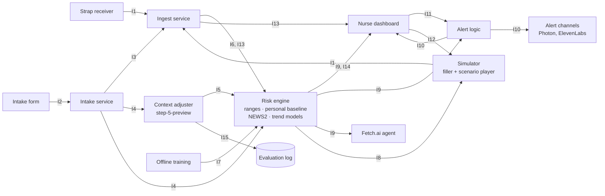

# Component Map and Interfaces

Oct 17, 2026 · @Nate

Every functional component, its owner, and the 15 interfaces between them. Build to these contracts so systems work and risk-model work run in parallel. Mirrors the [component map artifact](https://claude.ai/artifact/K5NvykgaQGoM5qhpP95fXL); if a contract changes, change it here first.

The demo has one patient, the wearer. The strap supplies real heart rate and breathing rate; the simulator fills in SpO2, temperature and triage BP from the wearer's predicted ranges; event buttons play scripted scenarios whose vitals replace the real ones for the event. No real/simulated tag in the data; the pitch says which is which.

## Diagram

Inside the risk engine, baseline ranges pass I8 to the personal baseline, scorers and alert logic. Sentry tracing and logs wrap the receiver, ingest, intake, risk engine and alerts.

## Components

| Component | Owner | Does | Reads | Writes | Start against |
| --- | --- | --- | --- | --- | --- |
| Strap receiver | Systems | Polar H10 over Bluetooth (bleakheart); HR + beat intervals about 1 Hz; contact flag; auto-reconnect; computes breathing rate | Bluetooth | I1 | The strap, printing to the console |
| Simulator | Systems | Fills SpO2, temp, triage BP from the wearer's ranges; scenario player replaces scripted vitals during an event | I8, I12 | I1 | Fixed NEWS2 normal ranges until I8 exists |
| Intake form | Systems | Nurse enters profile, conditions, meds, triage set, chief complaint; auto patient ID; assigns wearable | Nurse input | I2 | Nothing |
| Ingest service | Systems | FastAPI + WebSocket; merges strap and simulator per vital; wearable → patient; signal quality; rolling 60 s and one-minute medians; storage (Tiger Data) | I1, I3 | I6, I13 | Simulator |
| Intake service | Systems | Validates and stores the record; medication name → drug class (RXQ_DRUG); builds patient context | I2 | I3, I4 | Hand-written intake records |
| Context adjuster | Both | step-5-preview reads the full profile + chief complaint; tightens danger limits per vital, allowed rules only; evidence logged separately | I4 | I5, I15 | The ~100 self-written test texts |
| Evaluation log | Both | Facts + exact quotes per adjustment; scored against the test set | I15 | — | — |
| Offline training | Stats | NHANES quantile fit; PhysioNet 2019 (slow) and MIMIC-III minutes (fast); eICU replay to tune n₀, windows, cutoffs | Public datasets | I7 | Nothing |
| Risk engine | Stats | Python module, entry points at intake, every second (NEWS2), every minute (baseline, trends) | I4, I5, I6, I7, I13 | I8, I9, I14 | I6/I13 rows from eICU and recorded strap data |
| Alert logic | Stats | Persistence windows; NEWS2 ≥5 urgent, ≥7 high; trend cutoffs; one alert per problem; stays until acknowledged | I9, I11 | I10 | Recorded I9 rows |
| Nurse dashboard | Systems | Live vitals + NEWS2 each second; reason and NEWS2 points; ranges and trends; acknowledge and event buttons | I8, I9, I10, I13, I14 | I11, I12 | Stub risk engine (plain NEWS2) |
| Alert channels | Systems | Photon text (two-way), ElevenLabs voice; no Even G2 (Even Hub bans medical apps) | I10 | Text, voice | A "send test alert" button |
| Fetch.ai agent | Systems | ASI:One chat: "who needs a recheck right now?" | I9 | Chat answers | Stored I9 rows |

## Interface contracts

Shared rules: timestamps are LA local time with the UTC offset (`2026-10-18T10:15:03-07:00`); units are metric and °C; every field is nullable and a null is ignored, never filled in.

| ID | Name | From → To | Transport · cadence | Status |
| --- | --- | --- | --- | --- |
| I1 | Vitals reading | Strap receiver, Simulator → Ingest | WebSocket · about 1/s per source | Decided |
| I2 | Intake record | Intake form → Intake service | HTTP POST · once per patient | Decided |
| I3 | Wearable assignment | Intake service → Ingest | In-process call · on intake or reassignment | Tentative |
| I4 | Patient context | Intake service → Context adjuster, Baseline ranges | Function call · once at intake | Tentative |
| I5 | Context adjustments | Context adjuster → Baseline ranges | Function call · once at intake | Tentative |
| I6 | Minute summary | Ingest → Risk engine | Function call · every minute | Decided |
| I7 | Model files | Offline training → Risk engine | Files in models/ · loaded at startup | Tentative |
| I8 | Patient ranges | Baseline ranges → Personal baseline, scorers, alert logic, Simulator, Dashboard | In memory · set at intake, narrowed each minute | Tentative |
| I9 | Risk result | Risk engine → Alert logic, Dashboard, storage, Fetch.ai agent | WebSocket push to dashboard · every minute | Decided |
| I10 | Alert | Alert logic → Dashboard, Photon, ElevenLabs | WebSocket + channel APIs · when it fires | Tentative |
| I11 | Acknowledgment | Dashboard → Alert logic | WebSocket · on click | Deferred |
| I12 | Scenario trigger | Dashboard → Simulator | WebSocket · on event button | Tentative |
| I13 | Live window | Ingest → NEWS2 scorer (function call), Dashboard (WebSocket) | Every second | Tentative |
| I14 | Live NEWS2 | NEWS2 scorer → Dashboard | WebSocket · every second | Decided |
| I15 | Adjustment evidence | Context adjuster → Evaluation log | Append to file · once per intake | Tentative |

### Wire and scoring rules (fixed in P0)

Affects S2, S4, S5, T1, B1. Models live in `backend/contracts.py`; JSON Schema is exported to `schemas/`.

- **Field types:** every field nullable, default null, IDs included. Unknown fields are rejected. Timestamps must be timezone-aware; naive ones are rejected. Enumerated values are literal string sets exactly as listed below.
- **WebSocket envelope:** every message is `{"type": "<interface ID>", "data": {...}}`.
- **Endpoints (tentative):** `WS /ws/ingest` accepts I1. `WS /ws/dashboard` pushes I8, I9, I10, I13, I14 and accepts I11, I12. `POST /intake` takes I2 and returns the I3 assignment.
- **Band edges:** safe_low/safe_high and danger_low/danger_high are inclusive; a value at or below danger_low (or at or above danger_high) is danger. Stub I8: NEWS2 score-0 range is safe, score-3 values are danger. spo2 and temp_c have null danger_high.
- **Null scoring:** a null vital gets null points and is left out of the total; never filled in.
- **Rounding:** HR, RR and SpO2 round to whole numbers and temp_c to one decimal before banding, rounding half up (20.5 breaths becomes 21, 2 points; 24.5 becomes 25, 3 points).
- **NaN and infinity:** rejected by every model, so ingest (S2) must drop a non-finite reading (treat it as null) before building I6 or I13. `news2.score` also treats them as null for direct callers.
- **news2_points range:** 0-3 each, except on_oxygen which is 0 or 2.
- **SBP, alertness, on_oxygen** in I14 come from I4 triage held in engine state; with no intake they are null.
- **Cadence:** I6 is per minute. eICU is 5-minute, so fixtures never repeat a value into five rows; the I13 loader holds the latest I6 for up to 5 minutes, then null.
- **T1-T3 additions (affect S2, S3, S5):**
  - I8 safe band is always inside the NEWS2 score-0 range (the NHANES fit and the personal baseline can only tighten it), so a value shown as safe never scores NEWS2 points.
  - The simulator (S3) generates from the intake-time population I8 (`engine.intake_ranges[patient_id]`), never the personal one, to avoid learning its own noise.
  - Only hr and resp_rate get a personal band. spo2, temp_c and sbp stay population. Danger never moves in T1-T3.
  - `RiskEngine.on_minute` returns I9 only. When a patient's I8 changes it calls `engine.ranges_listener(PatientRanges)` so S2 can push I8 to the dashboard. `engine.ranges` is the current I8 per patient.
  - Triage SBP is typed at intake (S5), never generated by the simulator.
  - Pregnancy is not modelled in the population fit; the rule comes with the context adjuster.
- Open items unchanged: I5 rule list, I12 scenarios, I11 state, I9 fast-model fields (stub sets both trend probabilities null).

### I1 Vitals reading

| Field | Type / values |
| --- | --- |
| wearable_id | int |
| ts | timestamp |
| hr | bpm |
| rr_intervals_ms | [int], every beat since the last message |
| contact | bool, strap skin contact |
| resp_rate | /min, computed in the receiver |
| spo2 | %, from the simulator |
| temp_c | °C, from the simulator |

The simulator sends only the vitals it is filling or scripting, with the same wearable_id. Ingest takes the simulator's value for any vital it sent in the last few seconds, otherwise the strap's. Raw ECG (130 Hz) only if the dashboard gets a live waveform.

While the strap is disconnected or off the skin, the receiver sends `contact: false` about once a second with `hr` and `resp_rate` null, so a no-contact event is distinct from a fault. Ingest should treat those seconds as not clean. Affects S2.

### I2 Intake record

| Field | Type / values |
| --- | --- |
| patient_id | generated on submit |
| wearable_id | int, picked by the nurse |
| arrival_ts | timestamp |
| age | years |
| sex | male \| female |
| height_cm, weight_kg | number |
| pregnant | bool |
| conditions | [hypertension, asthma, cancer, diabetes, thyroid, copd, liver, heart_disease, stroke, heart_failure] |
| medications | [names as typed] |
| chief_complaint | free text |
| triage.sbp, triage.dbp | mmHg, taken once (simulated for the demo) |
| triage.alertness | alert \| new_confusion \| voice \| pain \| unresponsive |
| triage.pain | 0–10 |
| triage.on_oxygen | bool |
| triage.level | ESI 1–5 |

### I3 Wearable assignment

| Field | Type / values |
| --- | --- |
| wearable_id | int |
| patient_id | string |
| assigned_ts | timestamp |

One active patient per wearable; readings from an unassigned wearable are dropped and logged.

### I4 Patient context

| Field | Type / values |
| --- | --- |
| all I2 fields | including chief_complaint |
| bmi | computed from height and weight |
| drug_classes | [Multum classes. The fit uses beta_blocker, ssri, snri; others are ignored] |
| unmatched_medications | [names the lookup missed] |

### I5 Context adjustments

| Field | Type / values |
| --- | --- |
| patient_id | string |
| adjustments | [{rule_id, vital, bound, value}] |
| rule_id | from the allowed rule list (rules decided later) |
| vital | hr \| resp_rate \| spo2 \| temp_c \| sbp |
| bound | low \| high |
| value | new danger threshold, in the vital's units |

Tighten only: a high bound can only move down and a low bound only up. The engine clamps anything else. Facts and quotes are not passed here; they go to I15.

### I6 Minute summary

| Field | Type / values |
| --- | --- |
| patient_id | string |
| minute_ts | start of the minute |
| hr, resp_rate, spo2, temp_c | medians of clean readings, null if none |
| clean_seconds | 0–60, tentative |

Same format as the eICU replay and recorded strap files, so the risk engine can be built without the backend.

### I7 Model files

| File | Contents |
| --- | --- |
| ranges.json | HR and SBP: intercept + per-feature coefficients at the 2.5 / 50 / 97.5 quantiles, feature clamps, cohort means, fit coverage; reference safe bands for breathing, SpO2, temperature (model `RangesFile`) |
| rules.json | context adjustment rules and allowed IDs |
| fast_15, fast_30, slow | LightGBM model files |
| config.json | personal baseline settings (`baseline`: minutes, n₀ bounds, k, spread floors, minimum widths), persistence windows, probability cutoffs |

The engine runs on stub files at first (NEWS2 only), so systems work never waits on training.

### I8 Patient ranges

| Field | Type / values |
| --- | --- |
| per vital | hr, resp_rate, spo2, temp_c, sbp |
| safe_low, safe_high | population (NHANES fit or reference, ∩ NEWS2 score-0), then personal for hr and resp_rate |
| danger_low, danger_high | NEWS2 score-3 values, tightened only by I5 |
| source | population \| personal |
| reasons | ["typical heart rate 4 bpm lower: beta-blocker"] |

Warning is everything between safe and danger.

### I9 Risk result

| Field | Type / values |
| --- | --- |
| patient_id, ts | string, timestamp |
| level | safe \| warning \| danger |
| vital, reason | the vital driving the level, one line |
| news2 | 0–20 total, latest live value (I14) |
| news2_points | {resp_rate, spo2, on_oxygen, sbp, hr, alertness, temp_c}: 0–3 each |
| trend_prob_fast, trend_prob_slow | 0–1 |

Open: two fast models (15 and 30 min) but one fast field; no field yet for trend reasons.

### I10 Alert

| Field | Type / values |
| --- | --- |
| alert_id, patient_id, ts | string, string, timestamp |
| severity | warning \| urgent \| high |
| trigger | vital_danger \| news2_total \| warning_persisted \| trend |
| message | "Bed 4: breathing 26/min, 3 points" |

Repeat suppression lives in alert logic: one problem raises one alert.

### I11 Acknowledgment

| Field | Type / values |
| --- | --- |
| alert_id, ts | string, timestamp |

State and who acknowledged are decided in the demo-layer step.

### I12 Scenario trigger

| Field | Type / values |
| --- | --- |
| scenario_id | e.g. event_1; list comes later |
| patient_id | the wearer |
| start_ts | timestamp |

Each scenario is a scripted path for some vitals over a few minutes. Scripted vitals replace the real ones for the event, then hand back to the strap.

### I13 Live window

| Field | Type / values |
| --- | --- |
| patient_id | string |
| window_end_ts | end of the 60 s window (now) |
| hr, resp_rate, spo2, temp_c | medians of clean readings in the last 60 s, null if none |
| clean_seconds | 0–60, tentative |

Same format as I6, as a rolling window sent every second. The dashboard shows these as the live vitals.

### I14 Live NEWS2

| Field | Type / values |
| --- | --- |
| patient_id, ts | string, timestamp |
| news2 | 0–20 total |
| news2_points | {resp_rate, spo2, on_oxygen, sbp, hr, alertness, temp_c}: 0–3 each |

Alerts still go through alert logic and its persistence windows.

### I15 Adjustment evidence

| Field | Type / values |
| --- | --- |
| patient_id, ts | string, timestamp |
| items | [{rule_id, fact, quote}] |
| quote_found | bool, word-for-word match in the chief complaint |
| model | model and prompt version |

Never read by the risk engine. Used to score the adjuster against the labeled test set.

## Decisions and open questions

- Breathing rate is computed in the strap receiver; the simulator sends a breathing rate directly.
- The risk engine is a Python module with entry points at intake, every second and every minute.
- Alert logic owner: either works; listed as stats.
- Context adjuster model: step-5-preview (required for the StepFun challenge); Jev optional.
- Open: the context adjustment rule list (I5), the scenario list (I12), acknowledgment state (I11), fast-model fields in I9.
